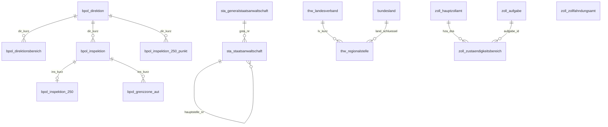

# BZB in PostGIS – Datenbank für OGC-Dienste

PostGIS-Schema für die **Behördenzuständigkeitsbereiche (BZB, BKG)** aus
`../bzb-bund/bzb/de` (18 Shapefiles, Themen Bundespolizei, Staatsanwaltschaften,
THW und Zoll).

> **Daten nicht im Repository.** BZB (nicht Open) ist laut Nutzungsbedingungen des BKG nur
> für Bundesbehörden und Nutzungsberechtigte nach § 4 V GeoBund freigegeben. Die Lieferung
> (`bzb/de/…`, `dokumentation/…`) bitte separat beziehen und nach `bzb-bund/` im
> Repository-Wurzelverzeichnis legen (in `.gitignore`) oder den Pfad mit `BZB_LIEFERUNG`
> in `.env` setzen. Ausgelegt als Datenbasis für WMS, WFS und OGC API Features
(GeoServer, QGIS Server, MapServer, pygeoapi, ldproxy, pg_featureserv).

```bash
export PGHOST=… PGDATABASE=… PGUSER=…   # libpq-Variablen
./laden.sh          # Schema anlegen (falls nötig), Shapefiles laden, prüfen
./laden.sh --neu    # Schemata bzb, bzb_ows, bzb_stage löschen und neu aufbauen
```

Voraussetzungen: PostgreSQL ≥ 15, PostGIS ≥ 3.3, GDAL ≥ 3.4 (`ogr2ogr`, `ogrinfo`).
Ein vollständiger Lauf dauert lokal etwa 15 Sekunden.

## Als WFS im lokalen Netz (Docker)

```bash
./start.sh          # .env mit Zufallspasswörtern anlegen, bauen, laden, GeoServer einrichten
./start.sh --neu    # dasselbe, vorher Datenbank und GeoServer-Konfiguration löschen
docker compose down # stoppen (Daten bleiben erhalten)
```

Voraussetzung: Docker (Desktop) und die BZB-Lieferung in `../bzb-bund` (änderbar mit
`BZB_LIEFERUNG` in `.env`). Der erste Start dauert 1–3 Minuten. Danach zeigt `start.sh`
die WFS-Adresse im LAN und die Zugangsdaten an, z. B.
`http://192.168.1.20:8080/geoserver/bzb/ows`.

| Dienst | Aufgabe | Erreichbar |
|---|---|---|
| `db` | PostGIS 17 / 3.5 | nur `127.0.0.1:DB_PORT` |
| `laden` | `laden.sh` + Dienstkonto `geoserver_bzb`, bei jedem Start (ca. 15 s) | – |
| `geoserver` | GeoServer 2.28 (kartoza, amd64 und arm64): WFS, WMS | **LAN**, Port `WFS_PORT` |
| `einrichten` | GeoServer per REST konfigurieren, idempotent (`docker/geoserver-einrichten.sh`) | – |

**Was eingerichtet wird:** Workspace `bzb`, PostGIS-Store auf `bzb_ows` mit
`gt_pk_metadata`, je View ein Layer mit Titel, Abstract und Schlagwörtern aus
`bzb.datensatz`. Veröffentlicht werden nur die Views, die `DB_LESEROLLE` lesen darf
(`bzb_leser` = alle Themen, sonst z. B. `bzb_leser_zoll`). Nicht mehr erlaubte Layer werden
beim nächsten Start entfernt.

**Zugriff:** Lesen nur mit Login (Rolle `ROLE_BZB_LESER`, Konto `WFS_BENUTZER`/`WFS_PASSWORT`
aus `.env`), Schreiben (WFS-T) nur für Admins; zusätzlich hat das Datenbankkonto nur
`SELECT`. Ohne Login sind Layernamen und Titel sichtbar; jeder Datenabruf (Karte, Features) antwortet
mit 401, sodass Browser und QGIS nach Benutzer und Passwort fragen (`KATALOG_MODUS=CHALLENGE`).
Mit `KATALOG_MODUS=HIDE` ist der Workspace für Anonyme komplett unsichtbar (404), dann fragt
der Browser aber auch nicht nach dem Login. `WFS_OEFFENTLICH=1` hebt den Login auf, aber nur
setzen, wenn die Nutzungsbedingungen das erlauben. Das Admin-Passwort von GeoServer gilt ab
dem ersten Start; zum Ändern `./start.sh --neu` oder in der Weboberfläche.

**Für Kolleginnen und Kollegen:** `start.sh` schreibt `weitergeben/bzb-eigen.toml`, eine
Quellen-Datei für den Zuständigkeitsfinder mit der aktuellen LAN-Adresse. Sie kommt in dessen
Ordner `quellen/`, die Zugangsdaten in die Umgebungsvariable
`ZF_BZB_EIGEN_AUTH=benutzer:passwort`. In QGIS: *Layer → WFS-Layer hinzufügen*, URL wie oben,
Authentifizierung *Basic*.

**Kommt keine Verbindung zustande:** die macOS-Firewall muss eingehende Verbindungen für Docker
erlauben, und beide Rechner müssen im selben Netz sein (Gäste-WLANs isolieren Geräte oft).
Ändert sich die IP-Adresse (DHCP), `./start.sh` erneut ausführen und die Datei neu weitergeben.

| Datei | Zweck |
|---|---|
| `docker-compose.yml` | Dienste, Ports, Volumes |
| `start.sh` | `.env` erzeugen (freie Ports, Zufallspasswörter), starten, Zugangsdaten ausgeben |
| `docker/werkzeug.Dockerfile` | GDAL 3.11 + psql + curl + jq für `laden` und `einrichten` |
| `docker/datenbank-laden.sh` | `laden.sh` ausführen, Dienstkonto anlegen |
| `docker/geoserver-einrichten.sh` | GeoServer-REST-Konfiguration |

## Aufbau

| Schema | Inhalt | Zugriff |
|---|---|---|
| `bzb` | Kernmodell, normalisiert, fachliche Schlüssel als Primärschlüssel | nur Eigentümer |
| `bzb_ows` | **eine View je Feature Type**, Metadaten-View, Punktabfrage | Leserollen je Thema |
| `bzb_stage` | Rohimport per `ogr2ogr`, wird bei jedem Laden neu erzeugt | nur Eigentümer |

Dienste lesen ausschließlich `bzb_ows`. Das Kernmodell kann sich ändern, ohne
dass sich Feature Types, Styles oder Clients ändern.

| Datei | Zweck |
|---|---|
| `sql/00_rollen.sql` | Leserollen `bzb_leser_bpol`, `_sta`, `_thw`, `_zoll` und `bzb_leser` (alle) |
| `sql/01_schema.sql` | Schemata, Tabellen, Constraints, Indizes, Codelisten |
| `sql/02_metadaten.sql` | Produkt-, Themen- und Layer-Metadaten (je Lieferung prüfen) |
| `sql/03_ows.sql` | Views, `gt_pk_metadata`, Funktion `zustaendigkeiten()`, Rechte |
| `sql/04_laden.sql` | `bzb_stage` → `bzb` in einer Transaktion, mit Verlustfreiheitsprüfung |
| `laden.sh` | ganzer Ablauf |

## Kernmodell



Alle Flächen sind `geometry(MultiPolygon, 25832)` mit GiST-Index und der
Prüfung `ST_IsValid AND NOT ST_IsEmpty`; die Übersichtspunkte sind `geometry(Point, 25832)`.
Das Speicher-CRS entspricht der Lieferung. Andere CRS liefert der Dienst durch
Transformation (empfohlen: EPSG:4326, 4258, 25832, 25833, 3035, 3857, 31467).

### Abbildung der Shapefiles

| Shapefile | Kerntabelle | View `bzb_ows.…` | `id` |
|---|---|---|---|
| BPOL_Direktionen | `bpol_direktionsbereich` (+ `bpol_direktion`) | `bpol_direktionen` | `dir_kn` |
| BPOL_Inspektionen | `bpol_inspektion` | `bpol_inspektionen` | `ins_kurz` |
| BPOL_DEU_AUT | `bpol_grenzzone_aut` | `bpol_deu_aut` | `esz` |
| BPOL_Inspektionen_250 | `bpol_inspektion_250` | `bpol_inspektionen_250` | `ins_kurz` |
| BPOL_Inspektionen_250_p | `bpol_inspektion_250_punkt` | `bpol_inspektionen_250_p` | `ins_kurz-n` |
| StA_Staatsanwaltschaften | `sta_staatsanwaltschaft` (+ `sta_generalstaatsanwaltschaft`) | `sta_staatsanwaltschaften` | `sta_nr` |
| THW_Landesverband | `thw_landesverband` | `thw_landesverband` | `lv_kurz` |
| THW_Regionalstellen | `thw_regionalstelle` | `thw_regionalstellen` | `rst_kurz` |
| Zoll_HauptZA | `zoll_hauptzollamt` | `zoll_hauptza` | `hza_dss` |
| Zoll_ZFA | `zoll_zollfahndungsamt` | `zoll_zfa` | `zfa_dss` |
| Zoll_Agrar, _Ausfuhr, _FKS, _KfzSteuer, _KfzSteuerFest, _StraBu, _Verwertung, _Vollstreckung | `zoll_zustaendigkeitsbereich` (Codeliste `zoll_aufgabe`) | `zoll_agrar` … `zoll_vollstreckung` | `aufgabe.dss`, z. B. `ausfuhr.2101` |

## Entwurfsentscheidungen

- **Views geben die Lieferung verlustfrei wieder.** Attributnamen entsprechen
  der BKG-Produktdoku (klein geschrieben, z. B. `dir_kn`, `landesbeau`), damit
  Styles und Filter für das Originalprodukt weiter passen. Zusatzattribute
  stehen hinten: `gsta_nr`, `generalstaatsanwaltschaft`, `hauptstelle_nr` und
  `ist_zweigstelle` (StA), `land_schluessel` (THW).
- **Ladeprüfung.** `04_laden.sql` vergleicht für jeden Layer alle
  Quellattribute und die Geometrie (WKB-Hash, mit Duplikaten) zwischen
  `bzb_stage` und der View. Bei einer Abweichung wird die Transaktion
  zurückgerollt und die Dienste behalten den alten Stand. Ungültige Geometrien,
  unbekannte Bundesländer und widersprüchliche Hierarchien brechen ebenfalls ab.
- **Stabile IDs.** Jede View hat eine `id` aus fachlichen Schlüsseln, keine
  Sequenz. Objekt-URLs in OGC API Features und Caches bleiben über Neuladungen gültig.
- **Hierarchien als Fremdschlüssel** statt mitgelieferter Namensfelder. Bei
  den Staatsanwaltschaften wird die Hierarchie aus `StA_Nr` abgeleitet:
  Stellen 1–4 ergeben die GStA, die Endung ≠ `00` kennzeichnet eine
  Zweigstelle. Die View erzeugt daraus `uebergeord` wieder, die Ladeprüfung
  bestätigt die Übereinstimmung mit der Lieferung.
- **Zoll: eine Tabelle für acht Aufgaben.** Die Aufgabe ist eine Codeliste.
  Ein zusammengesetzter Fremdschlüssel erzwingt, dass Aufgaben mit
  zuständiger Stelle (ZST) auch ZST-Angaben haben und Kfz-Steuer und StraBu nicht.
  Die ZST ist keine eigene Tabelle, weil ein Dienststellenschlüssel je Aufgabe
  unterschiedlich heißt (2150 = „Verw Berlin“ bzw. „Vollstr Berlin“).
- **Zugriff je Thema.** Die Nutzungsbedingungen geben die Daten je nach Vertrag
  an alle oder nur ausgewählte Bundesbehörden ab. Deshalb gibt es je Thema
  eine Leserolle. Ein Dienstkonto wird Mitglied genau der Themen, die es ausliefern darf.
- **Metadaten in der Datenbank.** `bzb_ows.datensatz` enthält je Feature Type
  Titel, Abstract, Schlagwörter, WGS84-Ausdehnung, Stände, Objektanzahl und
  Quellenvermerk („© BKG (2026), Datenquellen: …“). Daraus lassen sich
  Capabilities bzw. die Collection-Konfiguration erzeugen.

### Besonderheiten der Daten (Stand 2026-06)

- `BPOLD BBS` hat zwei Direktionsbereiche (Land und „See“), daher ist
  `bpol_direktion` (9) von `bpol_direktionsbereich` (10 Flächen) getrennt.
- Inspektionen verweisen teils auf einen Bereich statt auf die Direktion
  („BPOLD München - Bundespolizei Flughafen München“). Das bleibt in
  `zuordnung_kn`/`zuordnung_lang` erhalten.
- Der Übersichtspunkt `BPOLI FRA I-V` fasst fünf Inspektionen zusammen und hat
  daher keinen Fremdschlüssel auf `bpol_inspektion`.
- `Zoll_Ausfuhr` darf sich laut BKG überlappen
  (`zoll_aufgabe.ueberlappung_moeglich`), deshalb gibt es keinen Überlappungs-Constraint.
- `BPOL_Inspektionen_250` und `_250_p` dienen nur der Darstellung in
  Übersichtskarten (`datensatz.darstellung = 'uebersicht'`) und werden in der
  Punktabfrage nicht ausgewertet.

## Dienste anbinden

Ein Dienstkonto anlegen:

```sql
CREATE ROLE geoserver_bzb LOGIN IN ROLE bzb_leser;   -- oder nur bzb_leser_zoll usw.
\password geoserver_bzb
```

- **GeoServer:** einen PostGIS-Store auf Schema `bzb_ows` anlegen,
  *Primary key metadata table* = `bzb_ows.gt_pk_metadata`, *Expose primary keys* an.
  Die Option *Support on the fly geometry simplification* (Standard) sorgt für
  schnelle WMS-Übersichten. Die Layer sind die Views außer `datensatz`.
- **QGIS Server / MapServer:** `DATA "geom FROM bzb_ows.<view> USING UNIQUE id USING SRID=25832"`.
- **pygeoapi:** Provider `PostgreSQL`, `search_path: [bzb_ows, public]`,
  `id_field: id`, `table: <view>`, `geom_field: geom`. Titel, Beschreibung,
  Schlagwörter und Extent stehen in `bzb_ows.datensatz`.
- **Punktabfrage** (z. B. für den Zuständigkeitsfinder, Rolle `bzb_leser`):

  ```sql
  SELECT * FROM bzb_ows.zustaendigkeiten(8.2711, 49.9987);   -- lon, lat (WGS84)
  ```

  Die Abfrage liefert je fachlichem Layer die zuständige Stelle mit
  übergeordneter Stelle. An Grenzen und bei `zoll_ausfuhr` sind mehrere
  Treffer möglich. Laufzeit lokal etwa 30 ms für alle 15 Layer.

## Neue Lieferung

1. Shapefiles in `../bzb-bund/bzb/de` ersetzen (optional vorher `check.md5` prüfen).
2. Die Stände in `sql/02_metadaten.sql` laut `dokumentation/bzb.pdf` Kap. 3.2 anpassen.
3. `./laden.sh` ausführen. Bricht die Ladeprüfung ab, hat sich die Struktur
   der Lieferung geändert. Die Meldung nennt den betroffenen Layer.
